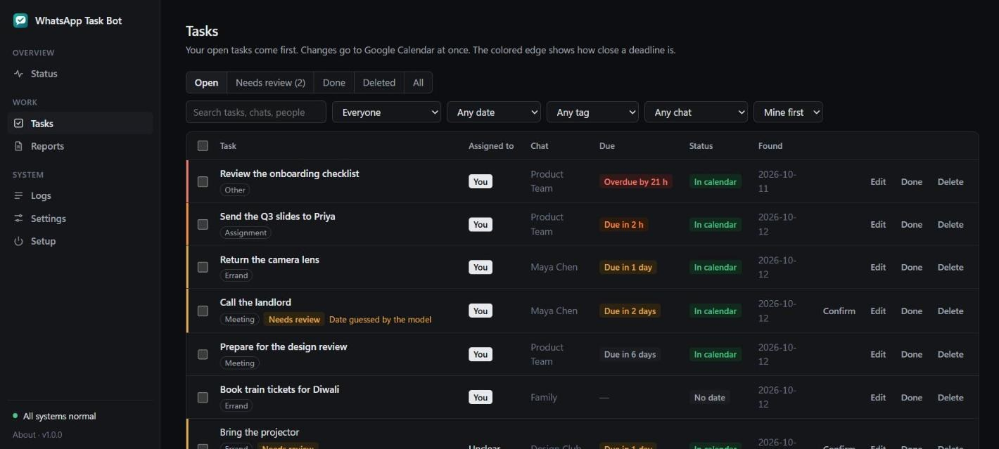
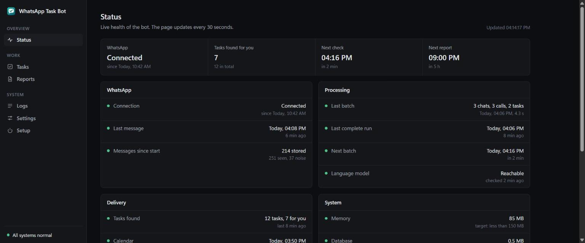
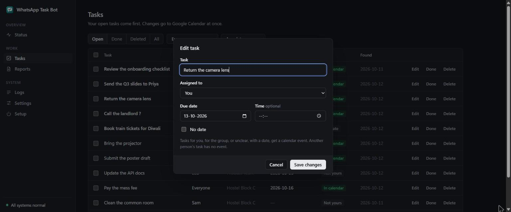
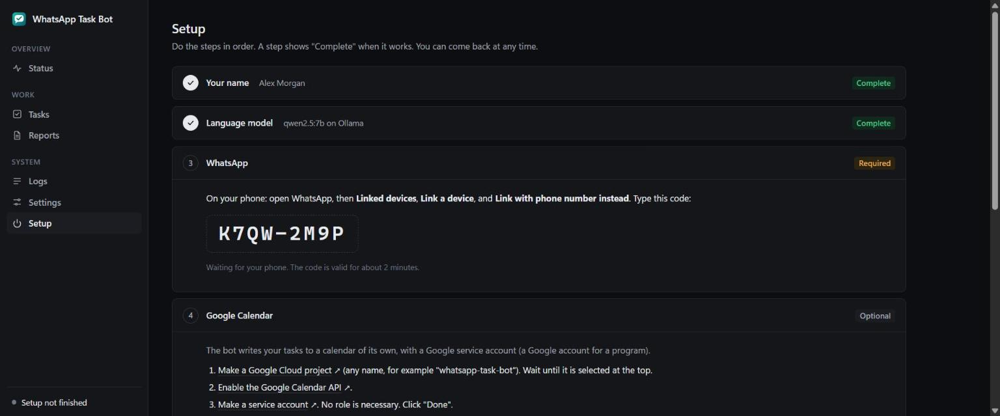
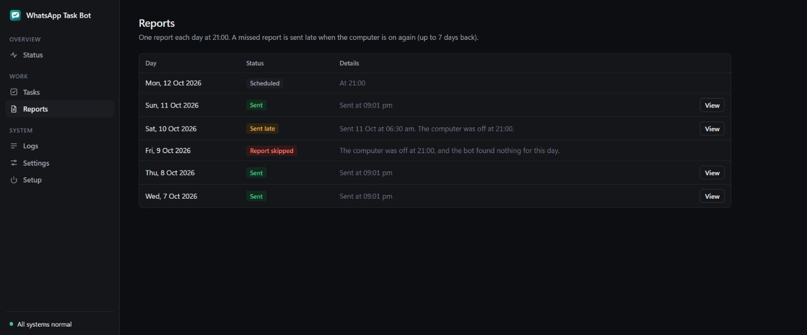
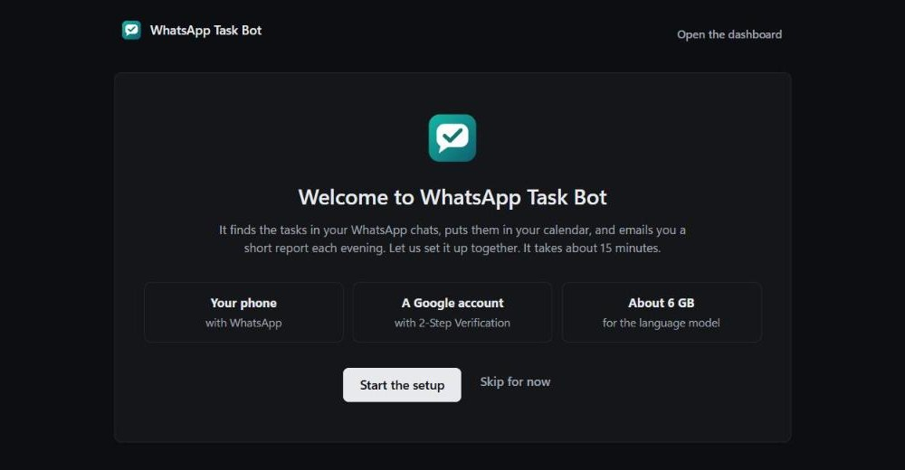
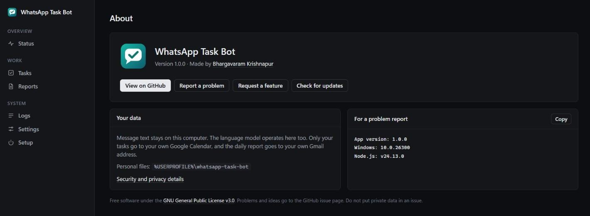
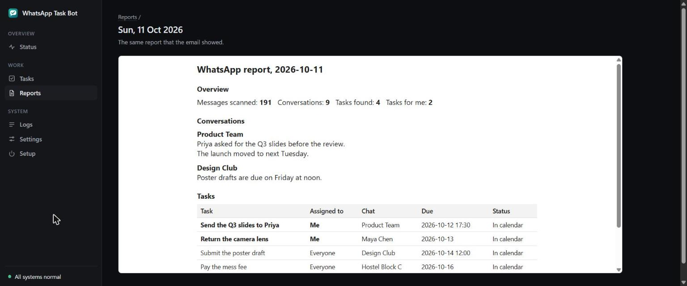
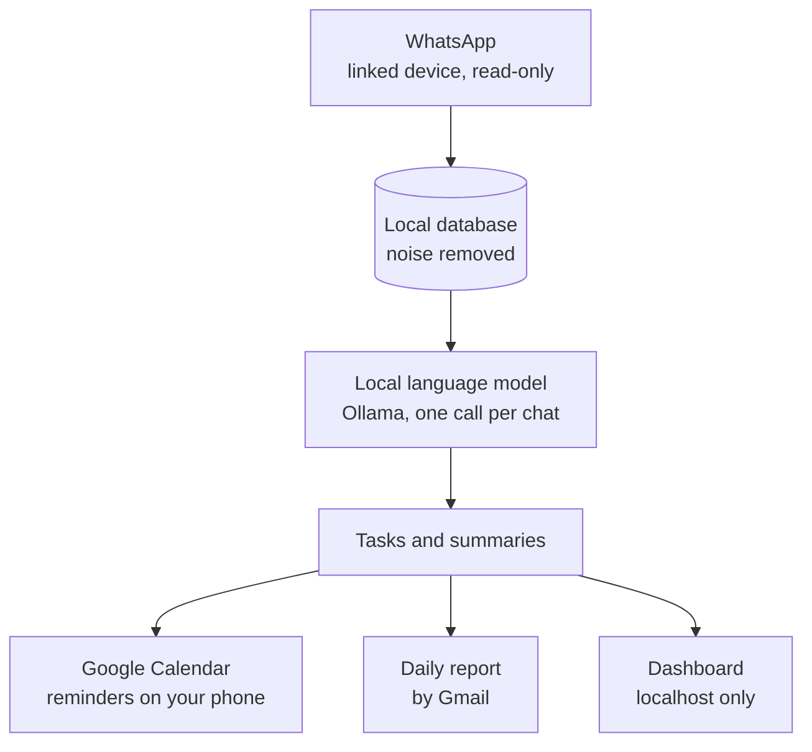

<p align="center">
  
</p>

<h1 align="center">WhatsApp Task Bot</h1>

<p align="center">
  Finds the tasks in your WhatsApp chats, puts them in Google Calendar with reminders on your phone,<br>
  and emails you a short report each evening. It only reads. The language model operates on your own computer.
</p>

<p align="center">
  <a href="https://github.com/Codex-Crusader/whatsapp-task-bot/releases/latest"></a>
  <a href="https://github.com/Codex-Crusader/whatsapp-task-bot/actions/workflows/ci.yml"></a>
  <a href="https://github.com/Codex-Crusader/whatsapp-task-bot/releases"></a>
  <a href="LICENSE"></a>
  
  
  
</p>

<p align="center">
  <a href="https://github.com/Codex-Crusader/whatsapp-task-bot/releases/latest"><b>Download for Windows</b></a>
  &nbsp;·&nbsp;
  <a href="#install">How to install</a>
  &nbsp;·&nbsp;
  <a href="CHANGELOG.md">What is new</a>
  &nbsp;·&nbsp;
  <a href="https://github.com/Codex-Crusader/whatsapp-task-bot/issues/new/choose">Report a problem</a>
</p>

<p align="center">
  
</p>

## What it does

1. Reads your direct messages and groups as a linked device, the same way as WhatsApp Web. It never sends a message, a reaction, or a read receipt.
2. Finds tasks with a language model that operates on your computer. Your messages do not go to a cloud service.
3. Puts your tasks in a Google Calendar of its own, so your phone gives you reminders.
4. Sends a daily report by email: what happened in each chat, and which tasks are yours.
5. Shows your tasks on a local dashboard: what is overdue, what is due today, and what needs a review. You can edit, complete, delete, and undo.
6. Marks uncertain tasks with a "Needs review" warning, and gives each task a tag, such as assignment, exam, or payment.

## Screenshots

The screenshots show the demo (`npm run demo`) with made-up data.

<table>
  <tr>
    <td width="50%"><br><sub><b>Status.</b> WhatsApp, the language model, the calendar, and the email at a glance.</sub></td>
    <td width="50%"><br><sub><b>Edit a task.</b> The change goes to Google Calendar at once.</sub></td>
  </tr>
  <tr>
    <td width="50%"><br><sub><b>Setup.</b> Six steps in the browser, each with a check.</sub></td>
    <td width="50%"><br><sub><b>Reports.</b> Late and skipped reports are shown per day.</sub></td>
  </tr>
  <tr>
    <td width="50%"><br><sub><b>Guided setup.</b> One step on each screen. You can skip any step.</sub></td>
    <td width="50%"><br><sub><b>About.</b> Version, update check, and links to report a problem.</sub></td>
  </tr>
  <tr>
    <td colspan="2"><br><sub><b>Daily report.</b> The same page goes to your email.</sub></td>
  </tr>
</table>

## How it works



The bot stores each new message in a local database. Every 10 minutes, it sends the new messages of each active chat to the language model in one call. The model finds the tasks and writes a short summary. Tasks for you, for the group, or for an unclear person, with a date, go to Google Calendar.

At the report time (21:00 by default), the bot does a last batch, makes the report, sends the email, and removes old data. If the computer is off at that time, the bot sends the report later, when the computer is on again.

## Install

1. Download `WhatsApp-Task-Bot-Setup-<version>.exe` from the [latest release](https://github.com/Codex-Crusader/whatsapp-task-bot/releases/latest).
2. Open the file. If Windows shows "Windows protected your PC", click "More info" and then "Run anyway".
3. Click through the installer. It needs no administrator rights, and it brings everything that the bot needs except Ollama.
4. The app opens in your browser with a guided setup.

> [!NOTE]
> The installer has no code signature, because a signature certificate costs money. For this reason, Windows SmartScreen shows a warning the first time. Each release has a `SHA256SUMS.txt` file. To make sure that your download is correct, compare it with the output of `Get-FileHash WhatsApp-Task-Bot-Setup-<version>.exe` in PowerShell.

The guided setup shows one step on each screen. Each step shows "Complete" when it works. You can skip a step and finish it later on the Setup page.

| Step | What you do |
|---|---|
| 1. Your name | Type the name that people use for you in WhatsApp. |
| 2. Language model | Click "Install Ollama" if necessary, then click once to download the model (about 4.7 GB). |
| 3. WhatsApp | Type your phone number, and type the code that the page shows on your phone. |
| 4. Google Calendar | Follow the links, upload one key file, and paste one Calendar ID. A test event makes sure that it works. |
| 5. Daily email | Paste a Gmail App Password. A test email makes sure that it works. |
| 6. Start with Windows | Click once. After that, the bot operates in the background with no window. |

After the setup, open the app from the Start menu or the desktop icon. If the bot does not operate, the app starts it and shows a loading screen until the dashboard is ready.

### Update and remove

To update, download the new installer and open it. The installer stops the bot, replaces the program files, and keeps your data. The About page in the dashboard tells you when a new version is available.

To remove the app, use "Installed apps" in the Windows settings. The uninstaller stops the bot and removes it from Task Scheduler. Then it asks if it must also delete your personal data.

The program files are in `%LOCALAPPDATA%\Programs\WhatsApp Task Bot`. Your personal data (the WhatsApp link, the database, the settings, the keys, and the logs) is in `%LOCALAPPDATA%\WhatsApp Task Bot`.

### Try the dashboard first

To see the dashboard before you set anything up, start the demo from a copy of the source code. It uses made-up data in a temporary folder, and it does not connect to WhatsApp or Google:

```
npm run demo
```

<details>
<summary><b>Run from the source code</b></summary>

1. Install [Node.js 24](https://nodejs.org/) or later.
2. Install [Ollama](https://ollama.com/download), and start it from the Start menu.
3. Download this repository, and open PowerShell in its folder.
4. Install the packages and start the bot:

   ```
   npm install
   npm start
   ```

5. Open the link that the bot shows in PowerShell. The guided setup opens.

A copy from the source code keeps all its data in the project folder. To build the installer, install [Inno Setup 6](https://jrsoftware.org/isinfo.php) and do `powershell -ExecutionPolicy Bypass -File scriptsuild-installer.ps1`. The installer goes to the `dist` folder.

</details>

## What you must have

1. A Windows 10 or Windows 11 computer with 8 GB of RAM or more.
2. About 6 GB of free disk space for the model.
3. A Google account with 2-Step Verification on, for the calendar and the email.
4. Your phone with WhatsApp.

A graphics card with 6 GB of video memory or more makes the model faster. The bot also operates without a graphics card, but each batch takes more time.

> [!WARNING]
> Baileys, the library that connects to WhatsApp, is not an official WhatsApp client. WhatsApp can block accounts that use unofficial clients. The bot only reads, which decreases the risk, but the risk is not zero.

## Privacy and security

| Data | Where it goes |
|---|---|
The language model operates on your computer, but tasks and the report leave it when you set up the calendar and the email:

| Data | Where it goes |
|---|---|
| Message text | Only this computer: the local database and Ollama. Kept for 48 hours. |
| Task title, chat name, sender, date | Your own "WhatsApp Tasks" calendar. |
| Original message text | Nowhere, by default. You can turn it on in Settings, and then it goes to the calendar event too. |
| Daily report | Your Gmail address. |

[SECURITY.md](SECURITY.md) lists how long the bot keeps each kind of data, and what to do if the computer is lost.

The dashboard listens only on `127.0.0.1`, and every page needs a secret access link. Secrets stay in `.env` and `keys\`, which git ignores, and the dashboard never sends them to the browser. npm runs no install scripts from dependencies. [SECURITY.md](SECURITY.md) has the details.

## Use the dashboard

The dashboard is a local web page. Only your computer can open it, and only with its access link. The desktop shortcut contains the link. If you lose the shortcut, do this command in the bot folder, and open the link that it shows:

```
npm run dashboard-url
```

The dashboard opens on your tasks. The sidebar has two groups: "Work" (Tasks and Reports) and "System" (Status, Logs, Settings, and Setup). The dot at the bottom of the sidebar shows the state of the bot. Click it to open the Status page.

| Page | What it shows |
|---|---|
| Tasks | All tasks, with a tag for each (assignment, exam, payment, and more). The buttons at the top count your overdue tasks, the tasks due today, the tasks of the next 7 days, and the tasks that need a review: click one to see those tasks. Search (press `/`), and filter by status, person, due date, tag, and chat. Sort by person, date, newest, or chat. A colored edge shows how close each deadline is: red when overdue, orange within 24 hours, yellow within 3 days. Edit, complete, delete, and restore tasks, one at a time or many at once. A delete asks first, because it also removes the calendar event. After a change, "Undo" reverses it. |
| Reports | One line for each day: "Sent", "Sent late", or "Report skipped". Click a day to see its report. |
| Status | The WhatsApp connection, the batches, the language model, the calendar, the email, memory, and recent errors. Green operates, red is a problem, gray did not occur yet. If something needs you, the Tasks page shows a short notice too. |
| Logs | The last 200 lines of the log. The log contains no message text. |
| Settings | Your names, the words that mark tasks, the chats to ignore, the report time, and the retention times. A change applies at once. |
| Setup | The setup steps. Come back here to link WhatsApp again or to change the calendar or the email. |

A change to a task goes to Google Calendar in a few seconds. A done task keeps its event, with a check mark and no reminders. A deleted task loses its event. Later reports use the changed task. A report that the bot already sent does not change.

<details>
<summary><b>The setup steps in detail</b></summary>

### Language model

If Ollama is not installed, install it from https://ollama.com/download, or do this command in PowerShell:

```
winget install --id Ollama.Ollama -e
```

Then start Ollama from the Start menu, and click "Check again" on the setup page. Ollama starts by itself when you log on to Windows.

### WhatsApp

1. On your phone, open WhatsApp, then "Linked devices", then "Link a device".
2. Tap "Link with phone number instead".
3. On the setup page, type your phone number with the country code (digits only). Click "Get pairing code".
4. Type the 8-letter code on your phone in 2 minutes or less.

If the code expires, ask for a new code after one minute. If the "Linked devices" list on your phone shows an old entry from an earlier try, remove it first.

### Google Calendar

A service account is a Google account for a program, not for a person. The bot uses it to write to one calendar that you share with it.

1. Make a Google Cloud project: https://console.cloud.google.com/projectcreate
2. Enable the Google Calendar API: https://console.cloud.google.com/apis/library/calendar-json.googleapis.com
3. Make a service account: https://console.cloud.google.com/iam-admin/serviceaccounts/create. Do not select a role.
4. Open the account, then "Keys", "Add key", "Create new key", "JSON". The browser downloads a key file.
5. Upload the key file on the setup page. Then remove it from your Downloads folder.
6. Make a calendar named "WhatsApp Tasks": https://calendar.google.com/calendar/r/settings/createcalendar
7. In the settings of the calendar, under "Share with specific people", add the service account email with "Make changes and see all event details".
8. Under "Event notifications", add reminders, for example 1 day, 1 hour, and 0 minutes before. A new calendar has no reminders. Without them, the events give no notification.
9. Under "Integrate calendar", copy the Calendar ID. Paste it on the setup page.
10. Click "Make a test event".

If a browser extension (for example VirusTotal) says that the key download failed, look in the Downloads folder first. The file is often there.

To get the reminders on your phone, the Google Calendar app (or the calendar app of the phone) must show the "WhatsApp Tasks" calendar. On some phones, you must also let the calendar app operate in the background.

### Daily email

An App Password is a 16-letter password that only one program uses.

1. Make sure that 2-Step Verification is on for your Google account.
2. Open https://myaccount.google.com/apppasswords. Make an App Password with the name "whatsapp-task-bot".
3. Paste the address and the App Password on the setup page. Click "Send a test email".

</details>

<details>
<summary><b>Commands</b></summary>

| Command | What it does |
|---|---|
| `npm start` | Starts the bot in this window. Press Ctrl+C to stop it. |
| `npm run demo` | Starts the dashboard with made-up data, without WhatsApp or Google. |
| `npm run dashboard-url` | Shows the access link for the dashboard. |
| `npm run dashboard-url -- --new` | Makes a new access token, if a link or a shortcut leaked. Restart the bot after this command. |
| `npm run link -- 91XXXXXXXXXX` | Links WhatsApp without the setup page. |
| `npm test` | Does the tests. |
| `npm run eval -- --chats <folder> --labels <file.csv> --me "Your Name"` | Measures how well the bot finds tasks (see "Evaluation"). |
| `powershell -ExecutionPolicy Bypass -File scripts\install-autostart.ps1 -StartNow` | Starts the bot with Windows (the same as the button on the setup page). |
| `powershell -ExecutionPolicy Bypass -File scripts\remove-autostart.ps1` | Stops the bot and removes it from Task Scheduler. |

The autostart task starts the bot at each log on. A second trigger starts it again within 5 minutes if it stops. Only one copy of the bot can operate. A second copy finds the dashboard port in use and stops.

</details>

<details>
<summary><b>Evaluation</b></summary>

The evaluation script measures how well the bot finds your tasks. It uses chat exports from your phone and a file with your labels.

1. On your phone, open a chat. Tap the menu, then "More", then "Export chat", then "Without media".
2. Put the `.txt` files in one folder on the computer.
3. Make a CSV file with one line for each message that you label:

   ```
   file,line,label
   WhatsApp Chat with CSE 3rd Year.txt,3,mine
   WhatsApp Chat with CSE 3rd Year.txt,7,other
   WhatsApp Chat with Ravi.txt,4,not_task
   ```

   The line is the line number where the message starts in the export. The label is `mine`, `other`, or `not_task`.
4. Start the evaluation. Write your name as it shows in the export:

   ```
   npm run eval -- --chats <folder> --labels <file.csv> --me "Your Name"
   ```

The script shows the precision and the recall for "mine", the number of LLM calls, the total time, and each error. A task for "everyone" counts as "mine", because the bot puts it in your calendar. To count only "me", add `--everyone-not-mine`. The folder `eval\sample` has a small example: try it with `--me "Alexander Morgan"`.

An export has no data for @mentions or replies. The script finds mentions from the "@Name" text. As a result, the evaluation results can be different from the live results.

</details>

### Tasks that need a review

When the bot is not sure about a task, it still puts the task in your calendar, so that you get the reminder. The event title starts with "?", and the dashboard shows a "Needs review" warning with the reason:

| Reason | Example |
|---|---|
| Unclear who must do it | "Someone book the lab" in a group |
| Low confidence | The model is less sure than the limit in Settings (0.6 by default) |
| Date guessed by the model | "Submit it after the holidays", with no date that the date parser understands |

Open the "Needs review" tab on the Tasks page. Click "Confirm" if the task is correct, or "Edit" to correct it. Both remove the warning and the "?" in the calendar. The Status page and the daily report show how many tasks need a review.

### Known limitations

1. The bot reads text, and the captions of images, videos, and documents. It does not read voice notes, images without a caption, stickers, polls, or locations.
2. The bot reads only messages that arrive while it is linked. It does not read the old messages in your chats.
3. A computer that is off or asleep does not read messages. When it is on again, WhatsApp sends the messages of the time that it was off, and the bot reads them then.
4. The language model can make mistakes: a wrong person, a wrong date, or a task that is not a task. Check the "Needs review" tab.
5. Baileys is an unofficial WhatsApp client. WhatsApp can block accounts that use it. Read the warning in "What you must have".

<details>
<summary><b>Problems and solutions</b></summary>

| Problem | Solution |
|---|---|
| A task has "?" in the calendar | The bot was not sure about it. Confirm or edit it in the "Needs review" tab. |
| The database is damaged ("database disk image is malformed" in the log) | Stop the bot. Rename the `bot.db` file in the data folder, and start the bot again. It makes a new database. You must link WhatsApp again, and the old tasks are not in the new database. |
| You removed the Google key or the App Password | Open "Setup", and upload a new key or paste a new App Password. Then make a test event or send a test email. |
| Windows shows "Windows protected your PC" | The installer has no code signature. Click "More info" and then "Run anyway". |
| The loading screen says "The bot did not start" | Read the log in `%LOCALAPPDATA%\WhatsApp Task Bot\logs`, and report the problem on GitHub. |
| The dashboard says "Access link needed" | Open the app from the Start menu. A copy from the source code: use the desktop shortcut, or do `npm run dashboard-url`. |
| "WhatsApp" is red and shows "logged out" | Your phone removed the linked device. Open "Setup" and link WhatsApp again. Your tasks stay. |
| "Language model" is red | Start Ollama from the Start menu. The bot checks each minute and reads the waiting messages as soon as Ollama answers. An Ollama update causes the same short break. |
| The calendar stays empty | Make sure that you shared the calendar with the service account email. Only tasks with a date get an event. |
| A calendar event gives no reminder | Add reminders to the "WhatsApp Tasks" calendar (see "Google Calendar", step 8). |
| The email does not arrive | Look in the spam folder. On the setup page, save a new App Password and send a test email. |
| "Cannot start: port 4780 in use" | A copy of the bot already operates. Use the remove script to stop it. |
| The shortcut shows a plain icon | Do `ie4uinit.exe -show` in PowerShell. |

</details>

<details>
<summary><b>Files</b></summary>

| File | Purpose |
|---|---|
| `src/main.js` | Starts the dashboard, the WhatsApp reader, and the scheduler |
| `src/launcher.js` | The app in the Start menu: shows a loading screen, starts the bot, opens the dashboard |
| `src/link.js` | Links WhatsApp from the command line (`npm run link`) |
| `src/dashboard-url.js` | Shows the access link, or makes a new token (`npm run dashboard-url`) |
| `src/setup.js` | Setup page and Settings page |
| `src/access.js` | Dashboard access token and desktop shortcut |
| `src/reader.js` | WhatsApp connection, link, caches for groups and contacts |
| `src/guard.js` | Read-only guard: gives the bot only the functions that do not send |
| `src/ingest.js` | Removes noise, makes compact rows, writes them in batches |
| `src/store.js` | SQLite schema and prepared statements |
| `src/filter.js` | Rule filter: gives each message a signal |
| `src/batcher.js` | One LLM call for each active chat, dates, persons |
| `src/extractor.js` | Prompt and calls to Ollama |
| `src/calendar.js` | Google Calendar events |
| `src/report.js` | Daily report as HTML |
| `src/mailer.js` | Gmail SMTP |
| `src/cleanup.js` | Removes old data each day |
| `src/scheduler.js` | Startup steps, batches, daily steps, late reports |
| `src/dashboard.js` | Local dashboard |
| `src/status.js` | Health values in memory |
| `src/config.js` | Reads and saves `config.json` and `.env` |
| `src/log.js` | Log file with rotation (5 MB, 3 files) |
| `scripts/demo.js` | Demo dashboard with made-up data |
| `scripts/build-installer.ps1` | Builds the installer with Inno Setup and a checked copy of Node.js |
| `installer/whatsapp-task-bot.iss` | Installer script |
| `.github/workflows/release.yml` | Builds the installer and publishes a release when a version tag is pushed |
| `CHANGELOG.md` | What changed in each release |
| `CODE_SIGNING.md` | Code signing policy, team roles, and privacy policy |
| `eval/evaluate.js` | Evaluation script |

`config.example.json` shows all settings. The bot makes `config.json` when you save the setup or the settings.

</details>

## Code signing policy

The installer is not signed yet. Signing is planned with free code signing from [SignPath.io](https://about.signpath.io) and a certificate by [SignPath Foundation](https://signpath.org). [CODE_SIGNING.md](CODE_SIGNING.md) has the policy, the team roles, and the privacy policy.

## Report a problem

Open the About page in the dashboard and click "Report a problem" or "Request a feature". The form on GitHub then has your app version. You can also [open an issue](https://github.com/Codex-Crusader/whatsapp-task-bot/issues/new/choose) directly. Do not put message text, phone numbers, email addresses, or keys in an issue, because issues are public. For a security problem, read [SECURITY.md](SECURITY.md) first.

## License

Copyright (C) 2026 Bhargavaram Krishnapur

This program is free software: you can redistribute it and/or modify it under the terms of the GNU General Public License, version 3, as published by the Free Software Foundation. This program comes with no warranty. See [LICENSE](LICENSE) for the full text.
